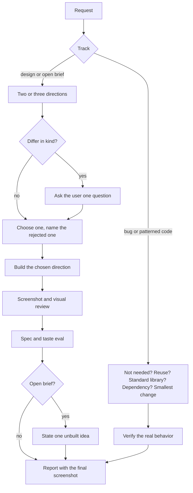

# Grok Cursor Rules

Cursor rules for Grok 4.7. They keep Grok's strong coding habits and add the parts it skips by default: compare design directions before building, review the rendered result from a screenshot, add one idea of its own, and ask you only about direction.

These rules are written for Grok in Cursor. A version for Grok outside Cursor, such as a Grok bot, is planned.

## Why

Grok is good at grounded, small-diff coding. On design and open briefs, the same habits make the output flat:

- It keeps the first plan that passes review, so it never compares directions.
- It scores "does this match the request?" and stops, so a correct but generic screen counts as done.
- It completes the prompt and rarely adds an idea that the prompt did not contain.
- It asks permission for small steps and almost never asks which direction you want.

Each rule fixes one of these with a procedure, not with adjectives such as "make it premium".

## Quick start

To use the rules in one project, copy the folder into that project:

```bash
git clone https://github.com/madebyaris/grok-cursor-rules.git
cp -r grok-cursor-rules/.cursor your-project/
```

To use them in every project, copy the files into your user rules folder:

```bash
mkdir -p ~/.cursor/rules
cp grok-cursor-rules/.cursor/rules/*.mdc ~/.cursor/rules/
```

Then choose Grok 4.7 as the model in Cursor.

## The rules

Six rules are always on. Two load only when the task needs them, to keep context small on plain coding turns.

| Rule | Loads | What it does |
|---|---|---|
| [`grok-think`](.cursor/rules/grok-think.mdc) | Always | Picks the coding or design track. On code, understand the flow, then reuse before you build. On design, write two or three directions and choose one. |
| [`grok-eval`](.cursor/rules/grok-eval.mdc) | Always | Scores safety, spec, grounding, consistency, regression, and evidence. On design, also scores taste from a screenshot and fails generic results. |
| [`grok-hitl`](.cursor/rules/grok-hitl.mdc) | Always | Decide alone, state an idea and continue, or stop. Stops for a direction fork, a change of goal, or an action that cannot be undone. |
| [`grok-invent`](.cursor/rules/grok-invent.mdc) | Always | On open briefs, adds one labeled idea that names the audience, a constraint, and a consequence. Does not build it unless you adopt it. |
| [`grok-visual`](.cursor/rules/grok-visual.mdc) | Always | Screenshots the rendered result at wide and phone widths, describes the image, checks it against rules of thumb, and fixes it in up to three rounds. |
| [`grok-write`](.cursor/rules/grok-write.mdc) | Always | How Grok writes replies, plans, docs, and UI copy. Outcome first, short complete sentences, one word for one thing, and no AI tells. |
| [`grok-plan`](.cursor/rules/grok-plan.mdc) | Plan mode | Reads before asking, plans risks and checks, and presents the plan with one visual per question: Mermaid, tables, wireframes, `/visualize` mockups, or a canvas. |
| [`grok-image`](.cursor/rules/grok-image.mdc) | When images fit | Uses Grok's native image generation for looks, and code for exact text or data. Covers prompts, consistency, real people, and checks. |

`grok-think` points to `grok-plan` and `grok-image`, so Grok still reads them when they are not loaded.

## How a task flows



## Status

The rules are not tested on real tasks yet. To test them, give Grok one prompt of each kind and compare the result with the expected behavior:

| Prompt | Expected behavior |
|---|---|
| Fix a broken button style | Coding track. A small fix, no new design directions. |
| Build a landing page from an open brief | Two or three directions, one chosen with a reason, a screenshot review, and one labeled idea. |
| Change a label to exact text | Built as asked, with nothing to choose. |
| Plan a feature in plan mode | `grok-plan` loads. Outcome first, a diagram, a file table, and checkable steps. |
| Add a hero illustration | `grok-image` loads. A generated image, checked before it is shown. |

## Roadmap

- Test the five prompts above and tune the rules from the results.
- Port the rules to Grok outside Cursor, such as a Grok bot.

## Sources

- [ASD-STE100 Simplified Technical English](https://www.asd-ste100.org/) for the sentence and word rules.
- [pstack](https://github.com/cursor/plugins/tree/main/pstack) principles: prove it works, never block on the human, attack the premise, technical writing, and unslop.
- [Ponytail](https://github.com/DietrichGebert/ponytail) for the reuse-before-you-build ladder.
- [Anthropic frontend-design skill](https://github.com/anthropics/skills/blob/HEAD/skills/frontend-design/SKILL.md) and [OpenAI frontend prompt guide](https://developers.openai.com/api/docs/guides/frontend-prompt.md) for design directions and product mode.
- [Refactoring UI](https://refactoringui.com/) and [Dieter Rams's principles](https://ifdesign.com/en/if-magazine/dieter-rams-10-principles-for-good-design) for hierarchy, spacing, and removal.
- [WCAG 2.2](https://www.w3.org/WAI/standards-guidelines/wcag/new-in-22/) for contrast and target sizes.

## License

[MIT](LICENSE)
